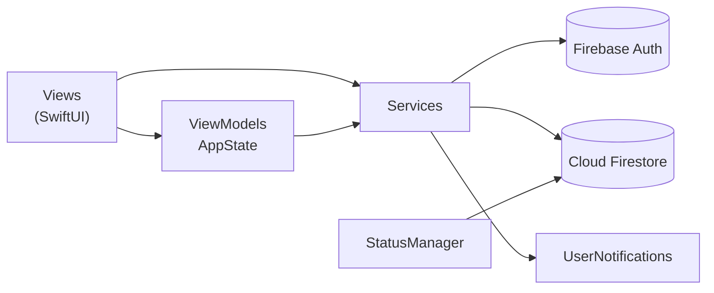

# Spinnet 🏓

**iOS-приложение для поиска партнёров по настольному теннису и организации турниров.**

<!-- Скриншоты: положи 6 файлов в docs/screenshots/ и убери эту строку и строку закрытия комментария

  
  
  

  
  
  

-->

## О проекте

Любителю настольного тенниса сложно найти партнёра своего уровня: договорённости теряются в мессенджерах, а турниры анонсируются в разрозненных чатах. Spinnet собирает это в одном месте: игрок публикует заявку на спарринг, другой бронирует её, участники согласуют детали встречи, а после игры оценивают друг друга.

Проект начинался как выпускная квалификационная работа (бакалавриат, 2026, оценка «отлично») и развивается дальше как самостоятельный продукт.

## Возможности

**Спарринги**
- Лента заявок в реальном времени, порциями по 20 с кнопкой «Показать ещё»
- Фильтры по городу, уровню, хвату и стилю игры
- Создание, редактирование и удаление заявки
- Бронирование и отмена: заявка возвращается в ленту, второй участник получает уведомление
- Автоматическая смена статусов по времени: `active → booked → in_progress → completed / expired`

**Согласование встречи**
- Вместо свободного чата — структурированные предложения: другое время, другое место, подтверждение, отмена; партнёр принимает или отклоняет
- Принятое предложение сразу меняет и заявку, и диалог
- Диалог появляется у партнёра только после первого сообщения — пустых диалогов нет

**Турниры**
- Многодневные турниры с лимитом участников, запись и отмена участия
- Организатор подтверждает и удаляет участников, редактирует и завершает турнир
- Завершённый турнир доступен только для просмотра

**Профиль и репутация**
- Уровень, хват, стиль игры, рейтинг TTW со ссылкой на профиль r.ttw.ru (ссылка проверяется)
- Вкладки «Игры / Участвую / Создаю» со сворачиваемыми секциями и статистикой
- Отзывы с оценкой 1–5 после игры: один отзыв на встречу, проверка текста, жалобы и модерация
- Имя и фамилию можно менять не чаще раза в 30 дней — защита от смены личности ради ухода от отзывов

**Безопасность общения**
- Взаимная блокировка: заблокированные пользователи не видят друг друга в ленте, не могут бронировать и писать; общие игры отменяются, профиль показывается как «недоступен»

**Уведомления**
- Напоминание за 3 часа до игры и просьба оценить партнёра через 2 часа после — у обоих участников
- Центр уведомлений с фильтрами, счётчики непрочитанного на панели вкладок в реальном времени
- Нажатие на уведомление открывает нужный раздел

## Стек

| | |
|---|---|
| Язык и UI | Swift, SwiftUI |
| Архитектура | MVVM + слой сервисов |
| Бэкенд | Firebase Authentication, Cloud Firestore |
| Уведомления | UserNotifications (`UNCalendarNotificationTrigger`) |
| Зависимости | Swift Package Manager |

## Архитектура

- **Models** — типизированные структуры (`SparringRequest`, `MeetingClarification`, `MeetingAction`, `Review`, `AppNotification` и др.) с отказоустойчивым `init?`: документ с отсутствующим или неверным полем не попадает в приложение.
- **Services** — вся работа с данными: `AuthService`, `SparringService`, `TournamentService`, `ClarificationService`, `ReviewService`, `NotificationService`, `BlockService`, `UserService`. Экраны не обращаются к Firestore напрямую: вся работа с данными — в сервисах и ViewModel.
- **StatusManager** — синглтон, переводит заявки и турниры между статусами по времени.
- **Views** — экраны SwiftUI на общей дизайн-системе (`AppColor`, `AppSpacing`, `AppRadius`, `AppSize`) и собственной панели вкладок с центральной кнопкой создания.

## Технические решения

**Денормализация под модель оплаты Firestore.** Firestore тарифицирует чтение документов, а не запросы. Имя и характеристики автора копируются в каждую заявку, поэтому лента из 20 карточек стоит 20 чтений вместо 40 — без запроса профиля на каждую карточку. Когда пользователь меняет профиль, копии в активных заявках и предстоящих турнирах обновляются одной пакетной операцией `WriteBatch`; завершённые игры не трогаются и хранят данные на момент встречи.

**Атомарные записи.** Бронирование заявки выполняется в транзакции Firestore: если её успел забронировать или удалить другой игрок, запись не перезаписывается. Создание диалога вместе с первым сообщением и принятие предложения (новое время или место меняет и заявку, и диалог) выполняются через `WriteBatch` — данные не могут оказаться в промежуточном состоянии.

**Real-time без утечек.** Лента, диалоги и счётчики непрочитанного работают на `addSnapshotListener`. Каждая подписка сохраняется и снимается при уходе с экрана и в `deinit`, перед повторной подпиской старая удаляется.

**Дешёвые счётчики.** Количество игр, турниров и уведомлений считается агрегирующим запросом `count()` — одно чтение вместо загрузки всех документов. История и завершённые турниры загружаются только при раскрытии секции.

**Взаимная блокировка.** Свой список хранится в `blocks/{uid}/blockedUsers`, а «кто заблокировал меня» находится запросом `collectionGroup` по индексу. Объединённое множество применяется в ленте, при бронировании и при открытии профиля.

**Напоминания обоим участникам без сервера.** Локальное уведомление можно поставить только на своём устройстве, поэтому каждое устройство само планирует напоминания для своих игр при загрузке. Идентификатор `reminder_{id}` делает операцию идемпотентной: повторный вызов перезаписывает уведомление, а не дублирует его.

**Офлайн.** Включён постоянный локальный кэш Firestore: повторное открытие экранов не обращается к серверу, записи без сети отправляются при её появлении.

## Модель данных

| Коллекция | Что хранит |
|---|---|
| `users` | профиль игрока, дата последней смены имени |
| `sparring_requests` | заявки на спарринг, статус, бронирование, копии данных автора |
| `tournaments` | турниры, участники и подтверждённые участники |
| `reviews` | отзывы, привязаны к конкретной встрече |
| `meeting_clarifications` | диалоги согласования встречи |
| `meeting_actions` | предложения внутри диалога и их статус |
| `notifications/{uid}/items` | уведомления пользователя |
| `blocks/{uid}/blockedUsers` | список заблокированных |

## Запуск

Требования: Xcode 26 или новее, iOS 18.0+.

1. Склонируйте репозиторий и откройте `Spinnet.xcodeproj`.
2. Создайте проект в [Firebase Console](https://console.firebase.google.com), включите **Authentication → Email/Password** и **Cloud Firestore**.
3. Добавьте в проект iOS-приложение с вашим Bundle ID, скачайте `GoogleService-Info.plist` и положите его в корень проекта, рядом с папками `App` и `Views`. Файл намеренно исключён из репозитория.
4. Опубликуйте правила безопасности из файла [`firestore.rules`](firestore.rules) (Firestore → Rules). Для админ-функций создайте документ `admins/{uid}` в консоли. Перед публикацией проверьте правила в Rules Playground.
5. Соберите проект — пакеты Firebase подтянутся через Swift Package Manager. Составные индексы Firestore создаются по ссылке из консоли Xcode при первом запросе.

## Ограничения и планы

- Уведомления пока локальные. Мгновенная доставка на устройство партнёра при закрытом приложении — через Firebase Cloud Messaging.
- Загрузка фото профиля и документов турнира (положение) — через облачное файловое хранилище.
- Рейтинг TTW вводится вручную; автоматическое получение с r.ttw.ru — в планах.
- Площадки: залы общежитий и спорткомплексы с отметкой «я сейчас играю».
- Unit-тесты бизнес-логики и сборка в GitHub Actions.
- Турнирные сетки и версия для Android.

## Автор

**Михаил Крупеня** — iOS-разработчик
Telegram: [@d3rav](https://t.me/d3rav) · GitHub: [@sibjou](https://github.com/sibjou)

## Лицензия

Исходный код открыт для ознакомления. Копирование и использование без письменного разрешения автора запрещено — см. [LICENSE](LICENSE).
