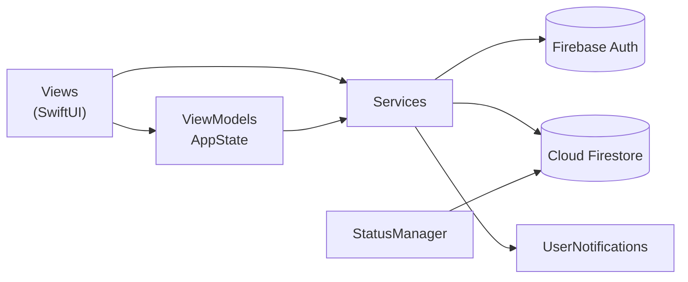

# Spinnet 🏓

**iOS-приложение для поиска партнёров по настольному теннису и организации турниров.**

<!-- Скриншоты: положи 6 файлов в docs/screenshots/ и убери эту строку и строку закрытия комментария

  
  
  

  
  
  

-->

## О проекте

Любителю настольного тенниса сложно найти партнёра своего уровня: договорённости теряются в мессенджерах, а турниры анонсируются в разрозненных чатах. Spinnet собирает это в одном месте: игрок публикует заявку на спарринг, другой бронирует её, участники согласуют детали встречи, а после игры оценивают друг друга.

Проект начинался как выпускная квалификационная работа (бакалавриат, 2026, оценка «отлично») и развивается дальше как самостоятельный продукт.

## Возможности

**Спарринги**
- Лента заявок в реальном времени, порциями по 20 с кнопкой «Показать ещё»
- Фильтры по городу, уровню, хвату и стилю игры
- Создание, редактирование и удаление заявки
- Бронирование и отмена: заявка возвращается в ленту, второй участник получает уведомление с именем того, кто отменил
- Потянуть вниз — обновить: лента, турниры и список диалогов
- Автоматическая смена статусов по времени: `active → booked → in_progress → completed / expired`
- Новая заявка по умолчанию — на сегодня: начало через час (округлено до получаса), игра на два часа; поздним вечером — завтра с 18:00. Выбор даты закрывается сам
- Даты и время собираются по шаблону языка системы через один слой `AppDate` / `AppLocale`: сейчас русский, а с появлением переводов порядок слов и названия месяцев переключатся сами

**Согласование встречи**
- Диалоги как в мессенджерах: аватар с точкой «в сети», имя, последнее событие, время, число непрочитанных и галочки ✓ / ✓✓ «прочитано»; внутри — разделители по дням
- Предложить своё время (дата, начало и конец, длительность считается сама) и место: поиск по названию и адресу или точка на карте (MapKit), метка видна партнёру, по нажатию открывается Apple Maps
- Обычные короткие сообщения («опаздываю на 10 минут», «я на месте») с лёгкой проверкой текста; подтверждение, отмена
- Принятое время или место сразу меняет и заявку, и диалог; принятая отмена возвращает заявку в ленту или закрывает её — в зависимости от того, кто отменил
- Диалог появляется у партнёра только после первого сообщения — пустых диалогов нет
- Онлайн-статус и «был(а) в сети» (настройка приватности «Показывать, когда я в сети»)

**Турниры**
- Многодневные турниры с лимитом участников, запись и отмена участия
- Организатор подтверждает и удаляет участников, редактирует и завершает турнир
- Завершённый турнир доступен только для просмотра

**Профиль и репутация**
- Уровень, хват, стиль игры, рейтинг TTW со ссылкой на профиль r.ttw.ru (ссылка проверяется)
- Вкладки «Игры / Статистика / Участвую / Создаю» со сворачиваемыми секциями
- Фильтры и сортировка истории, когда записей достаточно для выбора (игр от 4, матчей от 5, отзывов от 3): игры — период (7 / 30 / 90 дней, год, любой месяц, в котором были игры), роль (создал заявку / откликнулся), итог (победа, поражение, без счёта, не состоялась), город и поиск по сопернику и месту; матчи — период, результат и поиск по сопернику; отзывы — по оценке и «только с текстом»; сортировка по новизне, у игр и матчей ещё по сопернику, у отзывов по оценке; длинная история группируется по месяцам
- Отзывы с оценкой 1–5 после игры: один отзыв на встречу, проверка текста, жалобы и модерация
- Имя и фамилию можно менять не чаще раза в 30 дней — защита от смены личности ради ухода от отзывов

**Счёт матча и подтверждение**
- После игры любой из двух игроков вносит счёт по партиям (серия до 2, 3 или 4 побед); счёт проверяется по правилам: партия до 11, разница в 2 очка, после победы партий нет
- Второй игрок получает уведомление и может подтвердить счёт, один раз предложить свой или оспорить; видно, что изменилось
- В статистику идёт только подтверждённый счёт; подтверждённые и оспоренные матчи больше не меняются
- Через 15 минут после конца игры приходит напоминание «Внесите счёт» — оно открывает ввод счёта
- Если пара играла несколько раз за одну встречу, у каждой игры свой счёт: до 6 матчей на встречу, каждый подтверждается отдельно, следующий можно начать после решения по предыдущему; в статистику идут все подтверждённые

**Статистика игрока**
- Отдельная вкладка в профиле: победы и поражения, процент побед, серии, форма за 10 матчей, партии и очки, сыгранное время
- Графики на Swift Charts: активность по неделям, динамика процента побед, тепловая карта по дням и времени суток, личные встречи с каждым соперником
- Чужой профиль выглядит так же, как свой, — с теми же вкладками; он открывается из ленты, деталей игры, отзывов, турниров и диалога

**Приватность**
- Настройки → «Приватность профиля»: скрыть статистику и графики, историю матчей, турниры; запретить новые сообщения-уточнения
- Посетителю скрытый раздел показывается заглушкой, владелец видит всё

**Безопасность общения**
- Взаимная блокировка: заблокированные пользователи не видят друг друга в ленте, не могут бронировать и писать; общие игры отменяются, профиль показывается как «недоступен»

**Уведомления**
- Три напоминания у обоих участников: за 3 часа до игры («Скоро игра»), через 15 минут после конца («Внесите счёт» — открывает ввод счёта) и через 2 часа («Как прошла игра?» — открывает форму отзыва)
- Центр уведомлений с фильтрами и аватаром того, кто действовал; счётчики непрочитанного на панели вкладок в реальном времени
- Нажатие на уведомление открывает нужный экран: игру, диалог, ввод счёта или отзыв
- Уведомления о внесённом, подтверждённом, оспоренном и встречном счёте

## Стек

| | |
|---|---|
| Язык и UI | Swift, SwiftUI |
| Архитектура | MVVM + слой сервисов |
| Бэкенд | Firebase Authentication, Cloud Firestore |
| Уведомления | UserNotifications (`UNCalendarNotificationTrigger`) |
| Графики | Swift Charts |
| Тесты | XCTest |
| Зависимости | Swift Package Manager |

## Архитектура

- **Models** — типизированные структуры (`SparringRequest`, `MeetingClarification`, `MeetingAction`, `Review`, `AppNotification` и др.) с отказоустойчивым `init?`: документ с отсутствующим или неверным полем не попадает в приложение.
- **Services** — вся работа с данными: `AuthService`, `SparringService`, `TournamentService`, `ClarificationService`, `ReviewService`, `NotificationService`, `BlockService`, `UserService`, `PresenceService`. Экраны не обращаются к Firestore напрямую: вся работа с данными — в сервисах и ViewModel.
- **StatusManager** — синглтон, переводит заявки и турниры между статусами по времени.
- **Views** — экраны SwiftUI на общей дизайн-системе (`AppColor`, `AppSpacing`, `AppRadius`, `AppSize`) и собственной панели вкладок с центральной кнопкой создания.
- **Features** — модули «Матчи», «Статистика», «Чат» (время и место встречи, онлайн-статус), «Уведомления», «Приватность», «Premium», «Профиль»: модель, сервис и экраны рядом. Чистая логика (проверка счёта, расчёт статистики, права доступа) отделена от SwiftUI и покрыта тестами.

## Технические решения

**Денормализация под модель оплаты Firestore.** Firestore тарифицирует чтение документов, а не запросы. Имя и характеристики автора копируются в каждую заявку, поэтому лента из 20 карточек стоит 20 чтений вместо 40 — без запроса профиля на каждую карточку. Когда пользователь меняет профиль, копии в активных заявках и предстоящих турнирах обновляются одной пакетной операцией `WriteBatch`; завершённые игры не трогаются и хранят данные на момент встречи.

**Атомарные записи.** Бронирование заявки выполняется в транзакции Firestore: если её успел забронировать или удалить другой игрок, запись не перезаписывается. Создание диалога вместе с первым сообщением и принятие предложения (новое время или место меняет и заявку, и диалог) выполняются через `WriteBatch` — данные не могут оказаться в промежуточном состоянии.

**Real-time без утечек.** Лента, диалоги и счётчики непрочитанного работают на `addSnapshotListener`. Каждая подписка сохраняется и снимается при уходе с экрана и в `deinit`, перед повторной подпиской старая удаляется. При выходе из аккаунта подписки снимаются, а отметка «не в сети» уходит до завершения сессии.

**Дешёвые счётчики.** Количество игр, турниров и уведомлений считается агрегирующим запросом `count()` — одно чтение вместо загрузки всех документов. История и завершённые турниры загружаются только при раскрытии секции.

**Взаимная блокировка.** Свой список хранится в `blocks/{uid}/blockedUsers`, а «кто заблокировал меня» находится запросом `collectionGroup` по индексу. Объединённое множество применяется в ленте, при бронировании и при открытии профиля.

**Напоминания обоим участникам без сервера.** Локальное уведомление можно поставить только на своём устройстве, поэтому каждое устройство само планирует напоминания для своих игр при загрузке. Идентификаторы `reminder_{id}`, `match_{id}` и `review_{id}` делают операцию идемпотентной: повторный вызов перезаписывает уведомление, а не дублирует его.

**Онлайн-статус без сервера.** Пока приложение открыто, раз в минуту обновляются `isOnline` и `lastSeenAt` в профиле; «в сети» — значит отметка свежее 2,5 минут, поэтому закрытое приложение гаснет само. Скрытие времени захода — настройка интерфейса, не защита на уровне правил.

**Несколько матчей за встречу.** Документы `matches/{requestId}`, `matches/{requestId}_2` … `_6`: первый совпадает с прежним форматом, поэтому старые данные не нужно переносить. Лимит проверяют правила Firestore; порядок «сначала решить предыдущий» — приложение, в транзакции.

**Быстрый запуск.** Список блокировок и первая страница ленты запрашиваются одновременно, а не по очереди; список блокировок с прошлого запуска хранится на телефоне (`BlockSnapshot`) и применяется сразу, свежий приходит следом. Открытые вкладки не пересоздаются при переключении (экраны остаются в памяти), повторные загрузки ограничены `RefreshPolicy` (список турниров — не чаще раза в минуту), имена партнёров в истории читаются пачками по 30 через `in` и кэшируются на 5 минут (`TimedCache`), вместо чтения всей коллекции турниров — точечные запросы и `limit(100)`. В консоль Xcode печатаются отметки времени от запуска (`⏱ +412 мс  лента: первый ответ`) и длительность запросов (`⏱ длится 312 мс  блокировки: мои`) — в любой сборке, в том числе в Release (`Perf`). Цифры нужно снимать на устройстве в Release (Scheme → Run → Build Configuration → Release): Debug заведомо медленнее.

**Даты и языки.** Форматтеры создаются один раз и кэшируются (`AppDate`), локаль берётся из `AppLocale.current` и подставляется в `.environment(\.locale, …)`; язык разработки проекта — русский. Чтобы добавить язык, нужны String Catalog и запись в Localizations проекта; код экранов править не придётся.

**Офлайн.** Включён постоянный локальный кэш Firestore: повторное открытие экранов не обращается к серверу, записи без сети отправляются при её появлении.

**Подтверждение счёта.** Каждое изменение матча — транзакция Firestore. Подтверждающий видит конкретную версию счёта; если автор успел её исправить, подтверждение отклоняется, а экран показывает новый счёт. Правила Firestore допускают только разрешённые переходы (предложен → подтверждён или оспорен, встречный счёт один раз), а подтверждённый матч неизменяем.

**Доступ к платным функциям.** Расширенные графики подключены через `FeatureGate`: сейчас всё открыто (`paywallEnabled = false`). Чтобы ввести подписку, достаточно включить флаг и выдавать тариф `plan` с сервера — клиент это поле менять не может (запрещено правилами).

**Честно о доверии.** Проверки на клиенте и правила защищают от подделки одним человеком, но двое игроков могут договориться о любом счёте, а настройки приватности пока скрывают данные только в интерфейсе. Поэтому рейтинг по матчам не публикуется: следующий шаг — собственный сервер, который считает рейтинг и таблицы лидеров, ищет подозрительные кластеры встреч и применяет приватность на стороне данных.

## Модель данных

| Коллекция | Что хранит |
|---|---|
| `users` | профиль игрока, дата последней смены имени, настройки приватности, тариф |
| `sparring_requests` | заявки на спарринг, статус, бронирование, копии данных автора |
| `tournaments` | турниры, участники и подтверждённые участники |
| `reviews` | отзывы, привязаны к конкретной встрече |
| `matches` | счёт игры по партиям: статус (предложен / подтверждён / оспорен), версия, кто предложил; id = id заявки, у повторных игр встречи — `{id}_2` … `{id}_6` |
| `meeting_clarifications` | диалоги согласования встречи: счётчики непрочитанного и время прочтения у каждого участника |
| `meeting_actions` | сообщения и предложения внутри диалога (время, место с координатами) и их статус |
| `notifications/{uid}/items` | уведомления пользователя |
| `blocks/{uid}/blockedUsers` | список заблокированных |

## Запуск

Требования: Xcode 26 или новее, iOS 18.0+.

1. Склонируйте репозиторий и откройте `Spinnet.xcodeproj`.
2. Создайте проект в [Firebase Console](https://console.firebase.google.com), включите **Authentication → Email/Password** и **Cloud Firestore**.
3. Добавьте в проект iOS-приложение с вашим Bundle ID, скачайте `GoogleService-Info.plist` и положите его в корень проекта, рядом с папками `App` и `Views`. Файл намеренно исключён из репозитория.
4. Опубликуйте правила безопасности из файла [`firestore.rules`](firestore.rules) (Firestore → Rules). Для админ-функций создайте документ `admins/{uid}` в консоли. Перед публикацией проверьте правила в Rules Playground.
5. Создайте составные индексы из файла [`firestore.indexes.json`](firestore.indexes.json) (Firestore → Indexes, или `firebase deploy --only firestore:indexes`). Они нужны ленте и списку турниров для сортировки по дате; пока индексов нет, приложение работает и сортирует на телефоне.
6. Соберите проект — пакеты Firebase подтянутся через Swift Package Manager.

## Тестовые данные для скриншотов и проверки скорости

Скрипт [`tools/seed`](tools/seed/README.md) создаёт в Firestore сотни правдоподобных заявок, игр со счётом, отзывов и турниров в шести городах (площадки настоящие, люди и результаты придуманы), создаёт для них аккаунты для входа (почты `…@spinnet.test`) и умеет удалить всё добавленное. Сначала `python3 seed.py plan` — он показывает, что получится, и ничего не пишет в базу.

## Тесты

Запуск в Xcode: **⌘U** (схема `Spinnet`, таргет `SpinnetTests`). Тесты не ходят в сеть и не используют Firebase:

- проверка счёта по правилам настольного тенниса (партия до 11, разница в 2 очка, формат серии);
- модель матча и права игроков: кто может подтвердить, предложить свой счёт, оспорить;
- расчёт статистики: серии, форма, недели, тепловая карта, личные встречи;
- настройки приватности и доступ к платным функциям;
- логика диалогов: время и день сообщения, онлайн-статус и «был(а) в сети», предложение времени, галочки «прочитано», ссылки на карту;
- тексты уведомлений (кто отменил, склонения) и проверка текста сообщений;
- несколько матчей за встречу: номера, лимит, порядок;
- загрузка и кэш данных профиля;
- фильтры и сортировка истории: периоды и границы месяцев, группы по месяцам, роли и итоги, пороги показа панели;
- названия городов (`CityName`): «Мурманск », «мурманск», «Мурманска» и «Mурманск» с латинской буквой — один город, а не четыре пункта фильтра;
- кэши и ограничения частоты загрузки: `RefreshPolicy`, `TimedCache`, снимок блокировок, пачки имён по 30, отметки времени запуска;
- индекс матчей по заявке (`PlayerMatchesStore`).

Правила Firestore проверяются вручную в Rules Playground перед публикацией (диалоги видят только их участники; чужое сообщение от вашего имени и седьмой матч за встречу — запрещены): матч от не-участника, подтверждение собственного счёта, изменение подтверждённого матча и запись поля `plan` должны быть запрещены.

## Ограничения и планы

- Уведомления пока локальные. Мгновенная доставка на устройство партнёра при закрытом приложении — через Firebase Cloud Messaging; онлайн-статус при закрытом приложении определяется по времени последней отметки.
- Отправителя сообщений проверяют правила, но текст — только лёгкий фильтр на устройстве; полноценная модерация и жалобы на сообщения — на сервере.
- Место встречи пока предлагается только в диалоге; выбор точки на карте при создании заявки — в планах.
- Загрузка фото профиля и документов турнира (положение) — через облачное файловое хранилище.
- Рейтинг TTW вводится вручную; автоматическое получение с r.ttw.ru — в планах.
- Площадки: залы общежитий и спорткомплексы с отметкой «я сейчас играю».
- Сборка и тесты в GitHub Actions.
- Приватность и платный тариф пока применяются в интерфейсе; настоящее ограничение доступа и выдача тарифа — на собственном сервере.
- Рейтинг по подтверждённым матчам, таблицы лидеров по городу, вузу и общежитию, поиск накруток — следующий этап (нужен сервер).
- Турнирные сетки и версия для Android.

## Автор

**Михаил Крупеня** — iOS-разработчик
Telegram: [@d3rav](https://t.me/d3rav) · GitHub: [@sibjou](https://github.com/sibjou)

## Лицензия

Исходный код открыт для ознакомления. Копирование и использование без письменного разрешения автора запрещено — см. [LICENSE](LICENSE).
